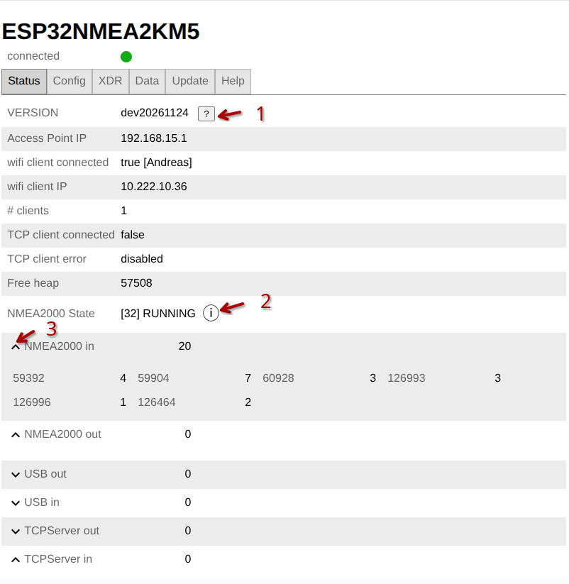
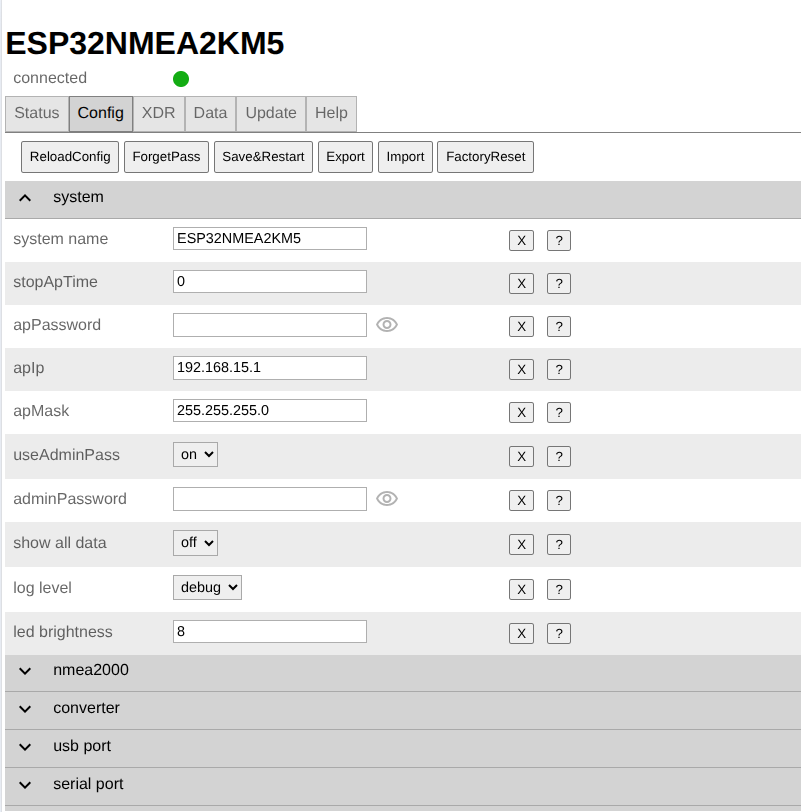
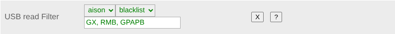
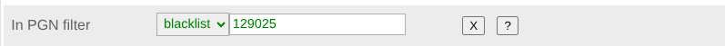
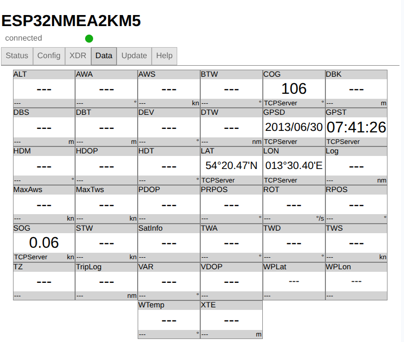

# The Web User Interface

## Connecting

After flushing the device it will create a wifi access point when it starts up. 

Connect to it (name: ESP32NMEA2K, password: esp32nmea2k).

Afterwards use a Bonjour Browser( [Android](https://play.google.com/store/apps/details?id=de.wellenvogel.bonjourbrowser), [IOS](https://apps.apple.com/de/app/bonjour-search-for-http-web-in-wi-fi/id1097517829)), the address ESP32NMEA2k.local or the ip address 192.168.15.1 to connect with your browser.

Once being connected you can change the system name (= name of the wifi network) and the IP and other parameters of the access point. As you can also change the passwords be careful to notice them as otherwise you would need to factory reset the device (very long button press until the led goes red).

If you are able to connect to the USB port it will print out the important paremeters on startup.

## Tabs
When connecting to the device with a browser you will get an UI with various tabs to access the device functions.

### Status

The first visible tab will present you the status information for the device.
The row with "connected" will show green if the UI is connected to the device and will turn red if not (any more).

Beside some system and connection information you will see the send and receive message counters for all available interface.

Each of them can be expanded (3) to provide you more details. For NMEA2000 channels the number of send and received PGNs is shown, for NMEA0183 channels the number for the various sentences.

Clickibg on the question mark beside the version (1) will give you the list of converted NMEA0183 sentences and NMEA2000 PGNs.

Clicking (2) will provide you a list of detecte NMEA2000 devices on your bus (including this device itself).
You can expand the device information by clicking it.

**Hint**: Populating this list can take some time after startup (> 1 minute) as we have to wait for some announcement messages from the devices.

## Config

Clicking the "Config" Tab will bring up the device configuration.

You can expand each section using the small arrow buttons. Each of the input fields has a help information available to explain the meaning.

After making changes you need to svae them and restart the device using "Save&Restart". If you have been connected to the device wifi it could happen that your device that runs the browser will just switch over to a different network. Therefore you will see a warning dialog about this fact.
You can always check the connected status to verify that you are still attached to the right network.

When klicking "Save&Restart" a couple of checks will be executed and an error will be shown if there are invalid settings.

For storing the changes the system will ask you for an admin password. Initially this is set to 'esp32admin' and it can be changed in the "system" section. The admin password dialog will allow you to store the password in your browser. Please consider that the password will be stored in cleartext in your browser data - so only do this on some personal device.

You can also perform import and export of your settings (as a json file), restting to factory settings - or just reloading from the device (this way reverting all changes before Save&Restart).

In the "nmea2000" section you can set a preferred NMEA2000 node id. When thi is set to a value != -1 the device will try to claim this address. If another device on the bus already has this address the device will select a different one. The device address is shown at the status tab in the 

`NMEA2220 state [32] Running`

Will show a node address of 32 (the initial defualt).

### Filters

The gateway supports filters at all inputs and outputs and also at the converter (to control which data passes from NMEA0183 to NMEA2000 and reverse).

#### NMEA0183
For NMEA0183 the filter looks like 

You can decice if you will allow AIS data (aison,aisoff) and if the provided filter should be a whitelist or blacklist.

In the filter list you can provide:

* a 3 character NMEA sentence identifier (like RMC)
* a 2 character Talker Id (like GX)
* a 5 character talker + sentence (like GPAPB)

The are checked in this priority. Multiple entries can be combined with a ,.

In the example the filter means: drop all messages from talker "GX", drop all "RMB" sentences and drop "GPAPB" records. All other messages will be pass (as aison is selected and the filter is a blacklist).

Seasmart sentences (`$PCDIN`) are not handled by this filter but by PGN filters.

#### PGN

For NMEA2000 you can filter by PGNs.

You can provide a list of pgns seperated by `,` . And you can decide if the filter should be a blacklist or a whitelist.

The example means: Drop all PGNs 129025.

**Remark**: If you select "whitelist" for a filter and leave the list empty this means to drop all messages.

### Seasmart

IP based connections support sending and receiving [seasmart](https://open-boat-projects.org/de/seasmart/) data. This allows you to forward the complete NMEA2000 traffic via IP. The seasmart data just encapsulates the NMEA2000 messages in an ascii format without any conversion. Using seasmart you can connect any capable device directly to the NMEA2000 network via IP.
The channels by default will always receive seasmart messages, sending has to be enabled explicitly. Additionally you have PGN filters at the channels so that you e.g. still can prevent receiving seasmart by an empty whitelist filter.

### Actisense

For the USB channel you can configure the mode to be either NMEA0183 or Actisense. If you select Actisense no log information is transmitted on this channel.

## XDR

On the XDR Tab you can configure the [XDR translations](XdrMappings.md).

## Data

On the data tab you will see current values of the received data **that has been passing the converter**.

Normally you will see both received data and data that could be received (but still has not been).

In the configuration you can limit the display to only received data.

Beside the data that is directly known by the gateway and will be shown once it was passing the converter all XDR data will also been shown on this page.

The values have a timeout (can be set at the "Config" tab, section "converter") so that they will disappear if not being received within this timeout. 

Each data value will show a caption, the value, the source that received the latest value and a unit. All not directly know data values (like XDR data) are shown in their SI base units. 

As the display is mainly intended for diagnosis purposes there is no sophisticated configuration for the display. You can easily use an app for more detailed and configurable display (like [AvNav](https://www.wellenvogel.net/software/avnav/newDoc/latest/en/index.html)).

## Update

On this tab you can [update the software](../Readme.md#update).

## Help

This Tab links to this documentation.

## Other tabs

User software that uses the gateway core can extend the UI by adding own tabs - see [Extending the software](../lib/exampletask/Readme.md).
